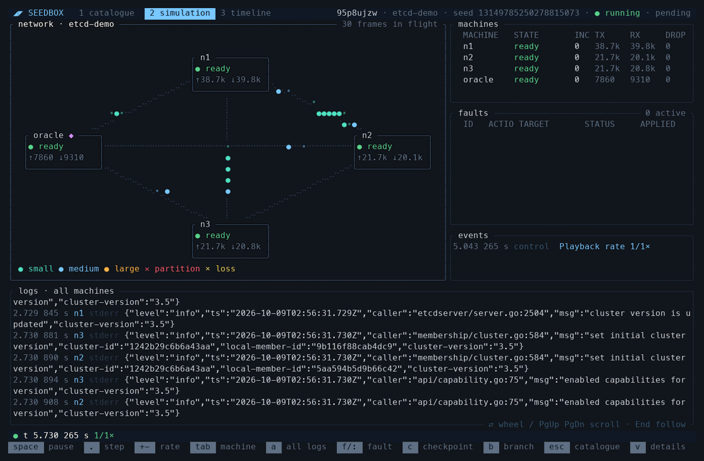

# Seedbox

> **⚠️ Early, buggy software.** 
> I vibe-coded the vast majority of this so temper your expectations. Expect slop, bugs, and dead code. Nothing api-wise is stable yet. 

Seedbox runs Linux applications in virtual machines with controlled time,
networking, and disk faults. A seed and recorded inputs let you repeat a
simulation and compare its results.



## Try it

Use an Apple Silicon Mac or Linux x86-64 host with access to `/dev/kvm`.
Install Nix and start Docker or Podman. Macs also need Apple's Command Line Tools.

```sh
nix develop
cargo xtask build-assets
cargo build --release
./target/release/seedbox run examples/etcd --paused --detach
./target/release/seedbox tui <sim-id>
```

On Apple Silicon the guest helpers include a DynamoRIO fork fetched from a
private GitHub repository with your SSH key (the `dynamorio-arm` flake input),
so `cargo xtask build-assets` needs read access to it.

The build embeds the guest kernel and helpers. Running Seedbox does not invoke
Nix or a compiler. Docker or Podman prepares application images.

If no server is running, the CLI asks before starting a persistent local one.
For scripts, start `seedbox serve` explicitly. `seedbox shutdown` stops the server
and its simulations.

In the TUI, press **Space** to resume. Press **f**, choose **Partition network**,
put `n1` on one side and `n2` / `n3` on the other, review the expected targets
and effects, and submit with **Enter**. The form shows the action category and
highlights previewed machines and links on the map.
Choose **Heal fault** to restore communication. Fault menus pause the simulation
and restore its previous playback state when closed. Click a pane to focus it;
use the mouse wheel to scroll logs. The **3 timeline** tab lets you edit recorded
faults and submit a new simulation.

## Run your application

Start with [the etcd example](examples/etcd/seedbox.yaml), or generate a project:

```sh
./target/release/seedbox init my-test --template etcd
./target/release/seedbox run my-test
```

`seedbox.yaml` defines machines and a separate **oracle**: the program that drives
the test and checks its results. Oracle exit code zero means pass; nonzero means
fail. An execution that ends without an oracle exit has no completed test verdict.
Applications and the oracle can also report **properties** through the
[`seedbox-sdk`](crates/seedbox-sdk) crate: `always`, `sometimes`, `reachable`,
`unreachable` and friends. A violated property fails a run even when the oracle
passes, and lost property evidence makes it incomplete; `seedbox get properties
<sim-id>` lists each one.
[evals/bank](evals/bank) is a small example with a planted bug.
Set `memoryMiB` on a machine or the oracle to choose its RAM independently.
Omission uses 1024 MiB; supported sizes are 64–3072 MiB on Apple Silicon and
64–65536 MiB on Linux x86-64. Preparation checks the image archive’s boot memory
requirement; applications may need more.

Images must match the guest architecture: `linux/arm64` on Apple Silicon,
`linux/amd64` on Linux x86-64. Pull private images with Docker or Podman first;
Seedbox does not integrate registry credential helpers.

## Inspect and repeat

Using `target/release/seedbox` as `seedbox`:

```sh
seedbox get simulations
seedbox get capacity                    # Occupied slots and queue reasons.
seedbox describe simulation <sim-id>
seedbox get properties <sim-id>          # Guest property results.
seedbox logs <sim-id>                    # Recent application output, all machines.
seedbox logs <sim-id> n1 --follow         # Stream one machine's output.
seedbox events <sim-id> --follow          # Structured simulator events.
seedbox replay <sim-id>                  # Rerun and compare results.
seedbox diagnostics <sim-id>             # List completed raw worker/console evidence.
seedbox export <sim-id> -o saved.seedbox.tar
seedbox import saved.seedbox.tar          # Fresh completed resource; no execution.
seedbox describe simulation <sim-id> > simulation.yaml
seedbox run simulation.yaml              # Submit the saved definition.
```

An omitted seed is chosen randomly. `rerun` repeats the oracle test; `replay`
also compares retained results and reports `MATCH`, `MISMATCH`, or
`NOT_COMPARABLE`. Use `seedbox help` or `seedbox help COMMAND` for options.

Simulation IDs, observations, and bounded log buffers last for one server
session. Binary assets survive restarts in the server's cache. Saved YAML needs
those assets; it is not a portable bundle. Export a completed, resolved simulation
to save its inputs, checkpoints, results, available raw diagnostics and bounded
log/event history independently of the session. Import registers a fresh independent
completed resource; use its ID to describe, compare, rerun, replay or branch from a
retained checkpoint. Export rejects active simulations. Imports are non-idempotent:
a cancelled or disconnected upload may still complete, so do not retry blindly.
Frames and missing/evicted observations are not recovered; omissions remain explicit.
`SEEDBOX_STATE` selects the server storage directory. Deleting simulations removes
the checkpoint state, imported binaries and edited boot archives that no remaining
simulation needs; saved YAML that names them then fails. Reusable inputs such as
kernels and prepared images are not automatically pruned.

## Search for bugs

```sh
seedbox explore . --count 20 --fault-profile faults.yaml     # A seed sweep.
seedbox campaign . --budget 32 --fault-profile faults.yaml   # Guided search.
seedbox get campaign <campaign-id>        # Members, assessment and findings.
seedbox get findings <campaign-id> --preceded-by crash --within 2s
seedbox shrink <sim-id>                   # Fewest external inputs that still fail.
seedbox explain <sim-id>                  # Faults, lifecycle, choices and properties in order.
```

A campaign starts as a seed sweep of roots that declare candidate anchors
(`--anchor`). Each later generation mostly branches from members that showed
something new (property outcomes, SDK events and states, setup, structured
choices) at one of their anchor captures, reseeded, sometimes with a changed
choice or a fault placed after one of the parent's events or states, and
spends a fixed share on fresh roots, some with only a sample of the profile's
fault kinds. Plans depend only on results, never on capacity or completion
order. Each finding's earliest member is exported to the state directory's
`findings/<campaign>`, as a cold rerun without checkpoints when that
reproduces it; `--baseline DIR` labels
findings new or observed again against an earlier campaign's directory, and
the exit status follows the campaign's assessment, for CI. Anchor captures hold
every machine's memory; members outside the corpus (`--corpus`) release theirs.

[Design](docs/design.md) explains the architecture and principles.
[Technical details](docs/internals.md) covers determinism, fault ordering,
checkpoints, and development checks.
