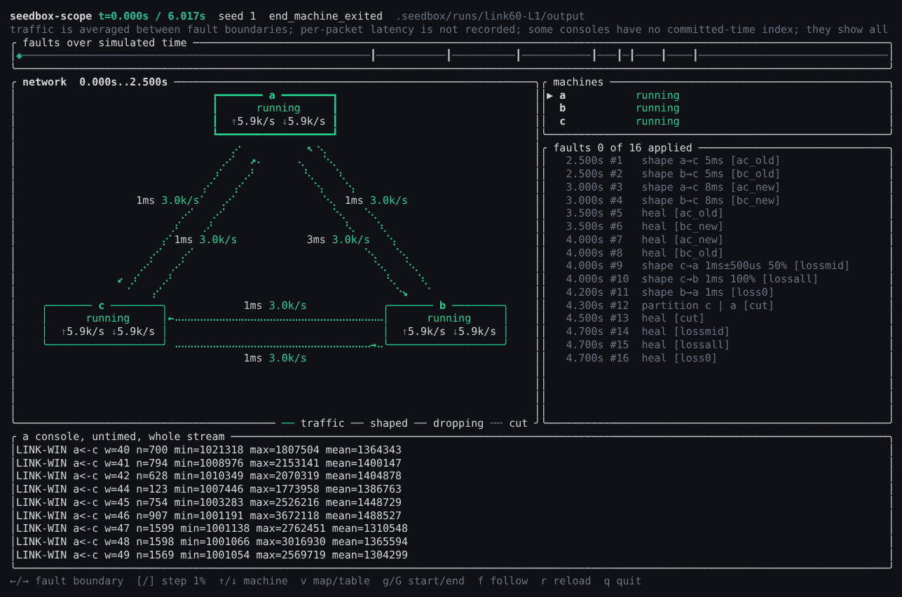
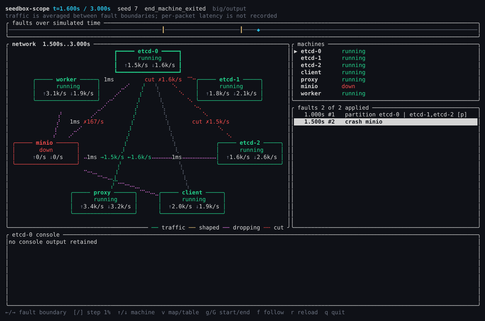

# seedbox-scope



A terminal viewer for a finished (or running) seedbox run. Move a cursor through
simulated time and see, at each moment:

- a network map: a box per machine, laid out to fit the panel, with arrows
  between them colored by link state (green traffic, yellow shaped, magenta
  dropping, dashed red cut) and labelled with latency and frames per second.
  With more than four machines the map focuses on the selected machine's links
  and shows other pairs only when they are cut, shaped or dropping;
- each directed link's effective policy (baseline, the winning shape, or a
  partition cut) and its delivered and dropped frames per second, as a table (`v`);
- each machine's state (running, down, paused, frozen, killed, incarnation, and
  active clock skews or throttles);
- the fault list, with what has been applied so far;
- the selected machine's console up to that time.

```sh
cargo run -p seedbox-scope -- .seedbox/runs/RUN
cargo run -p seedbox-scope                        # newest run in $SEEDBOX_STATE or .seedbox
cargo run -p seedbox-scope -- RUN --snapshot --at-ns 4300000000   # one plain-text frame
cargo run -p seedbox-scope -- RUN --snapshot --color --table      # ANSI colors, table view
```

Keys: `←`/`→` jump between fault boundaries, `[`/`]` step 1% of the run,
`↑`/`↓` select a machine, `v` switch between map and table, `g`/`G` start/end, `f` follow a live run, `r` reload,
`q` quit.



## Separation from the engine

The viewer reads only files a run already writes: `output/world.json` (links and
planned faults), `output/vmm.json` (applied faults, per-link counters and final
machine states) and `output/machines/NAME.console` with its `.chunks`
committed-time index. It depends on no seedbox crate and nothing depends on it,
so ratatui never reaches the CLI or the engine. It is not a default workspace
member; `cargo build` at the root does not build it. Nothing it does can change
a run, a witness or a replay.

## What it can and cannot show

The engine snapshots per-link counters at every fault boundary, so traffic is
shown as an average over the interval between two faults. Per-packet latency
and traffic between faults are not recorded yet. Following a live run shows
console output and machine names; faults and traffic appear when `vmm.json` is
written at the end.

`tests/fixtures/link60` is the L1 report from the #60 link-policy host run
(machine details and the removed counter-mode fields trimmed, host paths removed).
