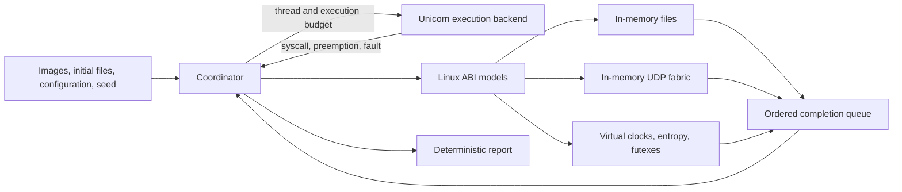

# Execution architecture

The coordinator owns every execution choice visible to the guest. Native code
runs only inside an instruction emulator. Resource operations either return
immediately or block a logical thread until the coordinator delivers a modeled
completion. All state is rebuilt from the manifest for each run.

## Existing interfaces

| Module | Responsibility and hook points |
| --- | --- |
| `backend.py` | ELF loading, guest memory, CPU contexts, `run(thread, budget, observer)`, `complete(thread, request, result)`, `clone` |
| `runtime.py` | Runnable-thread selection, instruction budgets, virtual time, event queue, thread lifecycle, result reporting |
| `kernel.py` | Linux ABI decoding and resource state; `handle` returns `Complete` or `Blocked`, with completion data and an optional deadline |
| `random.py` | Versioned SHA-256 streams, named domains, unbiased bounded choices |
| `config.py` | Validated immutable starting inputs and model policy |
| `linux_errno.py` | Guest Linux errno values, independent of the host OS |

These are working boundaries in the code. The backend currently targets x86-64
and Unicorn; there is no general backend plugin API yet. A different emulator
must preserve the budget and syscall-stop contract and pass the existing
acceptance workloads.

### Preemption

The scheduler chooses a runnable logical thread, then a step budget, using its
own seeded stream. The budget is bounded by the global execution limit and the
next timed event. Unicorn executes with a fixed count and no host-time timeout.
The code hook counts steps and rejects unmodeled instructions before they run.

At a syscall, the backend stops before executing the instruction. The
coordinator counts that boundary as an execution step, decodes the six Linux
x86-64 argument registers, and invokes the resource model. An immediate result
updates the saved CPU context and advances past the syscall. A blocked result
keeps the thread at the syscall until a later completion performs the same
update. RCX and R11 receive the expected syscall clobbers.

Shared-memory threads use separate saved CPU contexts and one address space.
Other nodes have separate address spaces. The race workload uses the actual
`clone` instruction path and shared guest memory, so scheduling can interrupt
its load/increment/store sequence. The corrected workload uses `lock inc`.

An execution step is a Unicorn code-hook entry. It normally corresponds to one
x86 instruction; repeated string operations expose individual iterations.
Faulting or rejected instructions can be counted at entry before any effects.
The tests establish exact budgets and resumable contexts for ordinary loops
and `REP` copies.

### Virtual time and completion order

Time starts at zero. Every entered execution step advances time by `tick_ns`.
Modeled syscalls observe time after their boundary step. Disk operations,
packets, sleeps, and futex timeouts insert events ordered by
`(deadline_ns, insertion_sequence)`. Equal deadlines therefore have a stable
order.

Execution stops early enough to deliver each pending event exactly at its
deadline. For an event between CPU ticks, time moves to the deadline before
executing the next step. If no thread is runnable, time advances directly to
the next event. If no thread can run and no event remains, the result is a
deterministic deadlock.

Futex wakeups and packet deliveries resume logical threads; they never wake
host execution threads. Obsolete timeout events are discarded and cannot move
virtual time. A syscall result is completed once using a monotonically assigned
wait identity, which prevents a stale timeout from completing a later wait.

### Randomness

The random-stream key combines a version marker, the unsigned 64-bit seed, and
a UTF-8 domain. SHA-256 of that key and a monotonically increasing block counter
provides buffered bytes. Bounded choices use rejection sampling.

The domains are:

- `schedule` for thread and budget selection.
- `entropy:<node>` for the initial `AT_RANDOM` bytes and guest `getrandom`.
- `disk:<node>` for operation faults.
- `network:<JSON [source, destination]>` for each directed link's loss,
  duplication, and jitter choices.

This keeps a change in network fault policy from consuming guest entropy or
scheduler randomness. It does not preserve the same schedule after a change
alters which threads are runnable. Run identity includes all model settings.

### Files and networking

Each node begins with private byte arrays for its files. File handles track
offsets and flags. Read, write, and fsync block until a timed completion; a write
captures its submitted bytes. Successful operations apply atomically at that
completion, and fsync takes a durable copy. Injected EIO applies no operation
effects. Opening, truncation, close, and seek are immediate in the current
model.

The fabric maps logical IPv4/port bindings to modeled sockets. Sending captures
the payload, chooses link faults and latency, and inserts packet events.
Delivery either completes a blocked receiver or appends to its bounded queue.
Partitions are checked at submission and delivery. Packets addressed outside
the modeled world are dropped, and nothing connects to a host network.

These are intentionally small resource models. The durable image supports
future crash testing, but process restart and persistence semantics are not yet
implemented. Likewise, the fabric can support a later TCP model, but today's
UDP datagrams do not establish realistic TCP behavior.

## Acceptance criteria for this milestone

1. A guest that never enters the kernel is preemptible and resumes without
   losing or duplicating execution steps.
2. Real guest threads share memory and expose an intentional lost update across
   seeds; changing the guest to an atomic increment restores the invariant.
3. Multiple guest processes exchange messages and block on disk, network,
   synchronization, and virtual timers without using host resources.
4. Timed events occur at the requested virtual time even while a CPU-only guest
   remains runnable.
5. A seed and pinned inputs regenerate the complete report in a fresh process,
   including under additional host CPU load.
6. Unknown operations stop explicitly, and guest errors use the Linux ABI
   independently of the host OS.

The tests and acceptance script exercise these criteria. Their successful
results are evidence for the supported execution contract, rather than a claim
that arbitrary Linux applications already run here.

## The compatibility decision

Unicorn supplies the instruction engine and saved CPU contexts without a host
kernel executing the guest. This makes preemption controllable on the current
Mac and leaves ABI behavior in ordinary code we can inspect. Its primary
upstream references are [the Unicorn project](https://github.com/unicorn-engine/unicorn)
and [its examples](https://www.unicorn-engine.org/docs/tutorial.html).

Before implementing a large POSIX surface, the next milestone should be one
real static C or Rust application with a standard runtime. It needs allocation
and mapping, TLS setup, basic libc startup syscalls, and descriptor operations.
Add supported behavior from observed application needs, with native fixtures
that cover successful operations and blocking/error paths. Preserve the current
race and cluster tests as regression oracles.

Then try a small network service and a database-style workload. Measure engine
cost and count missing kernel features before deciding the long-term execution
backend. There are two substantive paths:

| Path | Benefit | Cost to establish |
| --- | --- | --- |
| Expand the user-mode ABI models | Direct control of syscall-level faults and scheduling; simpler isolated models | Memory management, ELF linking, libc/runtime expectations, TCP, readiness, signals, filesystem and process semantics |
| Run a Linux guest under a controlled full-system emulator | Reuse Linux ABI implementation and ordinary container tooling inside the guest | Deterministic kernel/vCPU scheduling and interrupts; modeled block/network devices; backend changes and fresh determinism acceptance |

An OCI image loader only solves input packaging. It cannot supply the missing
Linux ABI or guarantee deterministic execution. A full-system backend would
need resource adapters at the block-device and virtual-NIC boundary; today's
syscall adapters cannot simply be reused unchanged.

The current coordinator, seeded policies, event ordering, and workload oracles
are useful in either path. Broad container compatibility remains an engineering
decision to validate with representative programs. No record/replay mechanism
is required for either architecture.
